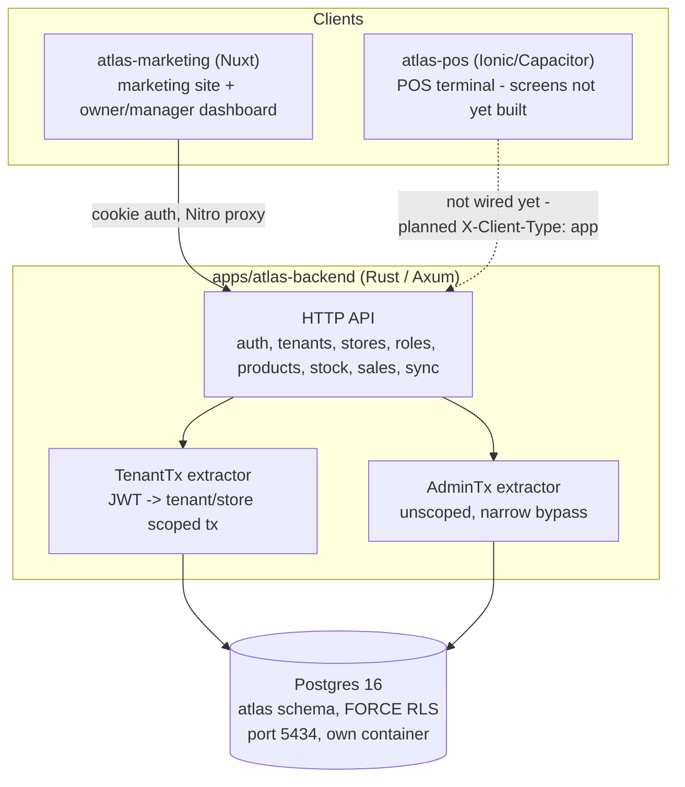

# Atlas SMS - System Design

Snapshot of the system as it actually stands in this repository, not the
aspirational version. Where a section describes something not yet built,
it says so explicitly. Sources: the migrations under
`apps/atlas-backend/migrations/`, the Rust source under
`apps/atlas-backend/src/`, `docs/atlas/CONTEXT.md` (locked architecture
decisions), `docs/atlas/auth-flow.md`, `docs/atlas/README.md` (the original
product design brief), and `docs/v2.md` (deferred scope).

---

## 1. What the system is

Atlas is a multi-tenant store management system: one tenant (a business)
runs one or more stores (branches), each with its own inventory, staff,
prices, and sales, while the tenant gets a shared catalogue and
cross-store reporting. Target scale per the PRD is 1-20 stores per tenant,
not a national multi-level org chart - that constraint shapes several
decisions below.

The product model has to fit a pharmacy, a boutique, a hardware shop, and
a restaurant without forking the codebase. Four mechanisms absorb that
variation instead of one schema per store type:

- **Product types with attribute schemas** - a product's type declares its
  own attributes (expiry, size, serial, grade); no per-type columns.
- **Units of measure** - a base unit plus sale units with conversion
  factors, quantity always decimal.
- **Stock item identity** - product-only, batch, or serial tracking is a
  flag on the product type, not special-cased sales code.
- **Module toggles per store** - recipe depletion, table orders, layaway,
  and similar behaviour-shaped features live behind a toggle, off by
  default.

Pricing sits apart from all four: price is the resolved answer to
(product, store, customer group, quantity, date) via price rules, not a
column on the product row.

---

## 2. Architecture at a glance

Atlas runs on its own Postgres server (`docker-compose.atlas.yml`, port
5434, database `atlas`), in its own container and volume, with tables in
an `atlas` Postgres schema rather than `public`. That separation is
deliberate at both the server level and the in-database schema level, so
an incident anywhere else has no path to this data.

---

## 3. Tech stack

| Layer | Choice | Notes |
| --- | --- | --- |
| Backend | Rust, Axum, sqlx (Postgres, no ORM) | Compiles; one integration test (`tests/health_check.rs`) |
| Database | PostgreSQL 16, row-level security | `atlas` schema, `atlas_api` app role (never the superuser) |
| Auth | JWT (access) + opaque refresh tokens, Argon2 password hashes | See section 6 |
| Web frontend | Nuxt 4 (Vue 3), SSR, Nitro proxy | `apps/atlas-marketing` |
| POS client | Vue 3 + Ionic + Capacitor | `apps/atlas-pos`, scaffold only |
| Shared UI | `@atlas/ui-{core,web,app}` (tsup, Storybook) | Component library, three-package split |
| Shared libs | `@atlas/{theme,composables,validation}` | Tailwind tokens, framework-agnostic helpers, zod schemas |
| Monorepo tooling | Nx, pnpm workspaces | `@nx/enforce-module-boundaries` gates package placement |
| CI | None yet | No `.github/workflows/` in the repo for either product |

The original product brief in `docs/atlas/README.md` proposed ASP.NET
Core + EF Core + Dapper. That was not what got built - the team reused an
already-proven Rust/Axum/sqlx/Postgres stack and Nx/pnpm tooling instead
of starting a second stack from zero. The document below describes what's
actually running.

---

## 4. Tenancy and access control

**Two levels of isolation that are not the same mechanism:**

- A **tenant** is the business. Isolated by row-level security - every
  tenant-scoped table is `FORCE ROW LEVEL SECURITY`, and a connection with
  no `app.current_tenant_id` set matches zero rows (fail closed, not
  fail open).
- A **store** is a branch inside a tenant. Partitioned, not walled off -
  `atlas.stores.tenant_id` is a direct foreign key with no ancestor chain,
  because Atlas's stated scale (1-20 stores) doesn't need a
  self-referencing organization hierarchy built for national-scale
  chains. A real franchise/holding-company hierarchy is tracked as
  possible-later in `docs/v2.md`, not built pre-emptively.

**Enforcement mechanism:** `TenantTx` (`apps/atlas-backend/src/extractors.rs`)
is a Rust extractor every tenant-scoped handler takes instead of a raw
pool connection. It requires a verified `Authorization: Bearer` JWT
(never a raw header), opens a transaction, and immediately calls
`set_config('app.current_tenant_id', ...)` / `app.current_store_id` from
the token's claims, so RLS enforcement happens inside Postgres itself, not
as an application-layer `WHERE tenant_id = ?` that a future handler could
forget to add. `AdminTx` is the explicit, narrow, unscoped sibling for the
handful of operations that legitimately predate or cross tenants (signup,
platform-role work) - never a runtime toggle on a `TenantTx` handler.

**Permissions:** `atlas.roles` (seeded system roles plus tenant-defined
custom roles) and `atlas.role_grants` (one row per user + role + tenant +
optional store; `store_id NULL` means tenant-wide). A single generic check,
`roles::service::assert_permission`, gates every handler - there is no
per-action bespoke SQL, and a granter can never hand out more permission
than they themselves hold. A permission is never just "can void sale"; it
is always "can void sale, in store 3."

**IDs:** UUIDv7, generated in Rust (`Uuid::now_v7()`), never a database
default - sequential IDs would let a tenant infer record counts from a
public store slug.

---

## 5. Data model

23 migrations, in build order:

| Area | Migrations | Rust module |
| --- | --- | --- |
| Core schema, users | `0001`-`0002` | - |
| Tenants, stores | `0003`-`0004` | `tenants/`, `stores/` |
| Roles, grants, RLS | `0005`-`0006` | `roles/` |
| Email OTP, refresh tokens, seeded roles | `0007`-`0009` | `auth/` |
| Product types, units, products | `0010`-`0012` | `products/` |
| Stock | `0013` | `stock/` |
| Module toggles | `0014` | none yet |
| Price rules | `0015` | none yet |
| Sales | `0016` | `sales/`, `sync/` |
| Purchasing | `0017` | none yet |
| Billing | `0018` | none yet |
| Audit events | `0019` | none yet |
| Product permission additions | `0020`-`0021` | `roles/` |
| Platform admin role | `0022` | - |
| Invites | `0023` | `roles/`, `auth/` (invite + accept endpoints, see section 6) |

Reading this table straight: the schema is ahead of the API for
`module_toggles`, `price_rules`, `purchasing`, `billing`, and
`audit_events`. Tables exist; no Rust handlers read or write them yet.
That gap is real and is the most honest single measure of "how much of
the design is actually live" right now.

---

## 6. Auth

**Built** (`apps/atlas-backend/src/auth/`, ~830 lines - the single largest
module in the backend):

- Signup (`POST /auth/signup`) - creates user + tenant + `owner` grant in
  one transaction, emails a 6-digit OTP.
- Verify email (`POST /auth/verify-email`) - consumes the OTP, activates
  the pending grant.
- Login (`POST /auth/login`) - 15-minute access JWT, 7-day opaque refresh
  token stored SHA-256-hashed (not Argon2 - it's a lookup token, not a
  password).
- Refresh (`POST /auth/refresh`) - rotates the refresh token on every use;
  a token presented twice is detectable because the second presentation
  hits an already-revoked row.
- **Invite a role** (`POST /api/v1/roles/invite`) - gated by `staff.invite`
  plus `assert_grantable` (a caller can never hand out a permission they
  don't hold). An existing verified user gets an `active` `role_grants`
  row directly; a new email gets an `atlas.invites` row and an email
  token, consumed by `POST /auth/invites/:token/accept`, which creates the
  user and the grant in one transaction. See section 4 for the full
  role/permission mechanism this sits on top of, and
  `docs/RolesAndPermissions.md` for the dedicated write-up.
- **Forgot / reset password** (`POST /auth/forgot-password`,
  `POST /auth/reset-password`) - same anti-enumeration shape as login,
  reuses the `email_otps` table.
- **Mobile token delivery for `atlas-pos`** - `login`/`refresh` branch on
  `X-Client-Type`: `web` gets `Set-Cookie` only, `app` gets the tokens in
  the response body instead (a Capacitor app has no server of its own to
  receive a cookie).

**Not built yet:**

1. **Tenant/store switching mid-session** - currently requires a full
   re-login. Low priority given the 1-20 store scale.
2. **Rate limiting** - not implemented anywhere (no rate-limiting crate in
   `Cargo.toml`). Tracked as a gap on `/auth/login`, not yet designed.

---

## 7. Offline

The PRD's requirement: "a shop in Lagos cannot stop selling because a
modem blinked," which means client-generated IDs, a device identifier on
every record, and an idempotent sync endpoint - decided before the sales
module was written, not bolted on after. All three are actually in place:

- `atlas.sales.id` is a client-generated UUID (comment on migration
  `0016`: generated on the device before it ever reaches the network).
- `device_id` is `NOT NULL` on every sale row.
- `POST /api/v1/sync/sales` (`sync/handlers.rs`) reuses the same
  `create_sale` service function as the live sale endpoint, keyed by the
  sale's own client-generated ID - calling it twice for the same sale (a
  retried request after a flaky reconnect) is a no-op the second time, not
  a duplicate sale or a double stock deduction.

What's not built: `atlas-pos` itself has no screens yet (see section 8),
so nothing currently calls this endpoint end to end. The server-side
contract is real; the client that exercises it isn't.

---

## 8. Frontend apps

**`apps/atlas-marketing`** (Nuxt 4) - carries both the public marketing
site and the authenticated owner/manager dashboard under one app, via a
Nitro proxy that handles cookie/Bearer auth and 401-retry. A single app
for both surfaces, rather than splitting marketing and dashboard into two
apps, was a deliberate choice, made explicitly. Currently two pages exist
(`index.vue`, `dashboard.vue`) plus a default layout - structure is in
place, screens are not built out.

**`apps/atlas-pos`** - point of sale is a native/tablet client per the
PRD, not a web page, so it's a separate Ionic + Capacitor app rather than
a route inside `atlas-marketing`. One stub page (`HomePage.vue`) and
router exist; no actual POS flow yet. Building it out is gated on the
invite flow and mobile token delivery (section 6), not on anything in the
offline design itself.

**`packages/atlas-ui/{core,web,app}`** - the three-package UI split
(`ui-core` for cross-platform Vue components, `ui-web` for desktop-only
chrome, `ui-app` for Ionic-native navigation/gestures) reuses a UI-kit
build pattern (tsup, Storybook) already proved out on an earlier project.
`ui-core` has 24 real components (buttons, stat cards, dialogs, form
inputs, a handful of marketing-site components) with Storybook stories
for 16 of them; `ui-web` and `ui-app` are currently thin re-exports of
`ui-core` with no platform-specific components added yet.

Gaps worth tracking before the design system is called solid for v1:
accessibility is barely started (only 3 of 24 components use any
`aria-*` attribute), component test coverage is effectively zero (1 spec
file total), and the component set skews toward the marketing site
(`section-faq`, `primary-link`, `web-button`) rather than the
dashboard/POS surfaces that will actually stress it (no data table,
badge, toast, tabs, or pagination component yet).

**No per-tenant theming.** `libs/shared/theme/src/lib/global.css` defines
one fixed set of design tokens (`--brand`, `--surface-*`, `--ink-*`, and
so on) with no override mechanism - no `data-theme`/`:root[...]` hook, no
per-tenant brand color, no dark mode. Every tenant currently sees the
same look. Nothing in the Atlas PRD explicitly requires white-labeling,
so this isn't a v1 blocker on its own, but it's worth deciding
deliberately rather than by default: if a larger tenant later asks to
match their own brand (dashboard color, receipt styling), the token
system has no hook for that today and would need one added, ideally
before dozens of components hardcode the current fixed palette rather
than after.

**`libs/shared/{theme,composables,validation}`** - Tailwind design
tokens, framework-agnostic composables (`useSeoMetaConfig`, `useSidebar`),
and zod validation rules, shared across every app. Kept genuinely
framework/product-agnostic on purpose.

---

## 9. Deployment and infra

- `docker-compose.atlas.yml` - Atlas's own Postgres (port 5434) and the
  `atlas-backend` API container, in their own volume, container, and
  network.
- `docker/atlas-postgres-init.sql` - creates the `atlas_api` role the app
  actually connects as; the admin URL (superuser) is only used for
  migrations, never at request time, so RLS can't accidentally be
  bypassed by the running API.
- No CI/CD pipeline exists yet.

---

## 10. Design decisions considered and rejected

Recorded so they don't get silently re-litigated:

- **Ancestor-chain tenant hierarchy** (a self-referencing
  `organizations.parent_organization_id` pattern, built elsewhere for
  diocese/state-ministry-style chains at national scale) - rejected for
  v1. Flat `tenant -> stores` fits the 1-20 store scale; a real
  `tenants.parent_tenant_id` hierarchy is tracked as possible-later in
  `docs/v2.md`, built only if an actual franchise/holding-company need
  shows up.
- **Fixed role enum** - rejected in favour of dynamic `roles` +
  `role_grants`, because a tenant needing a custom role (e.g. a title
  between cashier and manager) shouldn't require a code deployment.
- **Database-per-tenant** - considered in the original design brief,
  explicitly deferred: "cleaner on paper, will cost more in migration
  pain than it returns, at least until a customer demands it for
  compliance." Shared database with `tenant_id`/RLS is the working
  default; the option is kept open, not built now.
- **`store_group_grants`** (cross-store access short of full tenant-wide)
  - designed but deferred to v2, since the "regional manager over 3 of my
  5 stores" case doesn't block v1.
- **Per-tenant theming** - not designed yet at all, tracked as an open
  question in section 8, not a rejected option - unlike the others here,
  nobody has decided against it, it just hasn't come up as a real need.
- **CI pipeline** - not stood up yet; deferred until it's actually
  needed rather than invented ahead of the work it would gate.

---

## 11. How solid this actually is

Honest read of the state above, not a sales pitch:

**Solid:**

- The tenancy/security model (RLS + `TenantTx`/`AdminTx`, UUIDv7,
  permission containment checks) is fully designed, migrated, and
  enforced by every handler that exists - not a documented intent, a
  working mechanism with tests exercising the health check path.
- The offline-sync contract (client IDs, device IDs, idempotent sync
  endpoint) was designed before the sales module was written and is
  implemented exactly as specified, not retrofitted.
- Core commerce schema (tenants, stores, roles, products, units, stock,
  sales) is migrated and has real (not stubbed) service-layer code behind
  it, not just route stubs.
- The full auth lifecycle is built and wired: signup, verify, login,
  refresh (with rotation), invite + accept, forgot/reset password, and
  the `X-Client-Type` branch `atlas-pos` needs. A team can actually invite
  staff today, not just the signup-time owner - this was the single
  biggest gap as of the last audit and it's since closed.

**Not solid / open:**

- **Test coverage is one file** (`tests/health_check.rs`). None of
  `auth`, `products`, `roles`, `sales`, or `stock` have integration tests
  yet, despite `roles::service::assert_permission` being the single
  point every permission check in the system runs through - exactly the
  kind of function that should have direct test coverage before more is
  built on top of it.
- **No CI.** Nothing currently stops a regression from merging.
- **Five migrated tables have no API at all**: `module_toggles`,
  `price_rules`, `purchasing`, `billing`, `audit_events`. Pricing in
  particular is load-bearing to the whole product model (section 1) and
  isn't reachable yet.
- **`atlas-pos` has no real screens**, so the offline path that's fully
  built server-side has never been exercised end to end by an actual
  client.
- **No rate limiting**, anywhere, including on `/auth/login`.
- **Design system is thin against the harder screens.** `ui-core` has 24
  components but almost no ARIA coverage, effectively no component tests,
  and no per-tenant theming hook - see section 8. Fine for now since no
  dashboard or POS screen exists yet to stress it, but worth closing
  before those screens get built in earnest, not after.

**Net:** the architecture, data model, and full auth/invite lifecycle are
built out and match the design, not just documented as intent. The two
real gaps are commercial completeness (pricing, purchasing, billing,
audit - schema exists, no API yet) and test coverage on the permission
logic everything else depends on.

---

## 12. Suggested build order for what's left

Roughly in dependency order:

1. Integration tests for `roles::service::assert_permission` and the
   `auth` module - highest-leverage place to add coverage given how much
   depends on both, and the auth lifecycle is now complete enough to be
   worth locking down.
2. `price_rules` and `module_toggles` APIs - pricing is core to the
   product model, not a later nice-to-have.
3. `purchasing`, `billing`, `audit_events` APIs.
4. `atlas-pos` real screens, now that invite + `X-Client-Type` auth are
   both in place to support them.
5. Design-system accessibility and component test coverage (section 8) -
   before, not after, the dashboard/POS screens that will depend on it
   get built out.
6. CI pipeline, rate limiting, tenant/store switching, per-tenant
   theming - deferred until a concrete need forces the question, tracked
   here so they aren't forgotten.
