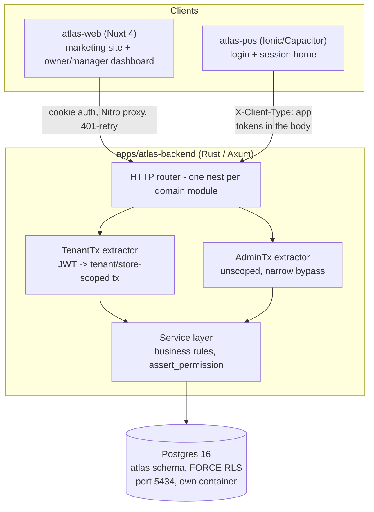

# ATLAS Store Management System - System Design Document

A multi-tenant, Postgres-backed Store Management System delivered as an
HTTP API (Rust/Axum) with a Nuxt web dashboard and a separate POS client,
built to the requirements in `Store Management System - Requirements.pdf`.
Modeled in structure on `ATLAS_System_Design (1).pdf` (a single-binary,
offline-first CLI design against the same requirements), but this document
describes the system actually built, not that one - the two solve the same
requirements brief with genuinely different architectures, for reasons
explained in Section 1.

|                     |                                                                               |
| ------------------- | ----------------------------------------------------------------------------- |
| Document ID         | ATLAS-SMS-2026-002                                                            |
| Version             | 1.0                                                                           |
| Status              | Reflects the codebase as of this writing, not a target                        |
| Source requirements | `Store Management System - Requirements.pdf` (82 requirements, 14 categories) |
| Classification      | Internal - Engineering                                                        |

---

## Table of Contents

1. Overview
2. High-Level Architecture
3. App & Package Layout
4. Storage Layer Design
5. Domain Model & Schemas
6. API Surface
7. Key Business Workflows
8. Access Control (RBAC)
9. Reporting Engine
10. Error Handling & Validation
11. Concurrency & Data Integrity
12. Testing Strategy
13. Requirements Traceability (19 of 82 fully met)
14. Future Extensions (v2+)
15. Alignment with Industry System-Design Practice
16. Data Protection & Backup
    Appendix A: Data Dictionary
    Appendix B: Document Control

---

## 1. Overview

ATLAS is a role-based Store Management System for small-to-mid chains: one
tenant (a business) runs 1-20 stores (branches), each with its own
inventory, staff, and sales, while the tenant gets a shared catalogue and
(eventually) cross-store reporting.

### 1.1 Why this isn't a single-binary CLI

The reference design (`ATLAS_System_Design (1).pdf`) targets one operator,
one machine, one store - a real and reasonable answer to the same
requirements brief for that scale. Atlas targets a different point on the
same brief: **multiple concurrent staff, multiple stores, one tenant**, at
minimum a cashier and a manager both writing to the same store's stock at
the same moment, and an owner viewing dashboards from a browser while a
till is mid-sale. That needs a real multi-user server and a database with
actual concurrent-write guarantees, not a single local process with a file
lock - the reference design's own Section 1.2 lists "multi-node /
concurrent-process access" as an explicit v1 non-goal for exactly this
reason. Atlas can't take that non-goal; concurrent access from more than
one person is the normal case, not an edge case.

### 1.2 Design Goals

- **Tenant isolation is structural, not conventional** - enforced by
  Postgres row-level security, not by an application-layer filter a
  handler could forget.
- **Correctness over speed of delivery** - every mutation runs inside one
  database transaction; nothing is written half-complete.
- **Offline resilience where it matters most** - the POS client, not the
  whole app, is designed to keep selling through a dropped connection.
- **Extensibility without rewriting the domain** - product variation
  (pharmacy vs. boutique vs. hardware shop) is absorbed by data
  (attribute schemas, unit conversions, price rules), not by forking code
  per store type.

### 1.3 Non-Goals (current)

- A single-tenant, offline-only deployment mode - the multi-tenant/RLS
  model is load-bearing throughout, not an add-on.
- A reporting engine and a notification system are scoped in the source
  requirements and are not built. Mutating handlers do write
  `audit_events`. There is no audit read API. See Sections 9, 13, and 16.
- CI/CD - not invented ahead of the work it would gate.

---

## 2. High-Level Architecture



Four logical layers, each depending only on the one beneath it - the same
separation-of-concerns goal as the reference design, achieved with a
network boundary and a real database instead of a CLI parser and files:

1. **Router** (`apps/atlas-backend/src/*/mod.rs`) - one `Router<AppState>`
   per domain module, nested under `/api/v1/<noun>` in `lib.rs`.
2. **Extractors** (`src/extractors.rs`) - `TenantTx`/`AdminTx`, described
   in Section 4. Nothing downstream can obtain a database connection any
   other way.
3. **Service layer** (`src/*/service.rs`) - business rules, permission
   checks, cross-entity orchestration (e.g. a sale touching `sales`,
   `stock_movements`, and `shifts` in one transaction).
4. **Postgres** - the system of record. No ORM; `sqlx` with hand-written,
   compile-time-checked SQL.

---

## 3. App & Package Layout

Nx monorepo, pnpm workspaces - the reference design's "crate & module
layout" equivalent:

```
apps/
  atlas-backend/          # Rust/Axum API
    migrations/           # sqlx migrations, schema of record (through 0024)
    src/
      auth/                # signup, login, refresh, me, switch, platform invite
      tenants/ stores/     # tenant + store CRUD
      roles/               # roles, grants, assert_permission/assert_grantable
      products/ stock/     # catalogue, inventory ledger
      sales/ sync/         # shifts, sales, offline sale sync
      purchasing/ payments/ customers/
      audit.rs
      extractors.rs         # TenantTx / AdminTx
      rate_limit.rs
      error.rs               # ApiError
    tests/
      health_check.rs
      auth_flow_tests.rs
      roles_permission_tests.rs
      commerce_tests.rs
  atlas-web/         # Nuxt 4 - public site, auth screens, dashboard
  atlas-pos/               # Ionic/Capacitor - login and session home
packages/atlas-ui/
  core/ web/ app/           # shared Vue component library, three-package split
libs/shared/
  theme/ composables/ validation/
```

Every service depends on `TenantTx`/`AdminTx`, never a raw connection
pool - the same "swap the implementation without touching business logic"
goal the reference design gets from its `Repository<T>` trait, achieved
here by the extractor being the only door into a transaction.

---

## 4. Storage Layer Design

### 4.1 Principles

- **Postgres is the store, not a cache in front of one.** No JSON files,
  no in-memory index rebuilt at startup - reads and writes go straight to
  the database, which already gives crash-safety, concurrent access, and
  durability as platform guarantees rather than hand-rolled ones.
- **Tenant isolation lives in the database, not the application.** Every
  tenant-scoped table has an identical shape:
  ```sql
  ALTER TABLE atlas.<table> ENABLE ROW LEVEL SECURITY;
  ALTER TABLE atlas.<table> FORCE ROW LEVEL SECURITY;
  CREATE POLICY <table>_isolation ON atlas.<table>
      USING (
          coalesce(nullif(current_setting('app.bypass_tenant', true), ''), 'off') = 'on'
          OR tenant_id = nullif(current_setting('app.current_tenant_id', true), '')::uuid
      );
  ```
  A connection with no `app.current_tenant_id` set (and no explicit
  `AdminTx` bypass) matches zero rows on every one of these tables. This
  is the direct structural equivalent of the reference design's "atomic
  write, nothing left half-written" guarantee, aimed at a different
  failure mode: not a crash mid-write, but a query that forgot its tenant
  filter.
- **Schema versioning via migrations**, not a JSON envelope's
  `schema_version` field - 23 ordered `sqlx` migration files are the
  single source of truth for the schema, run in order, each one
  transactional.
- **Money is integer minor units** (`amount_minor BIGINT`), never a bare
  float - avoids the classic floating-point cash-total drift the
  reference design's `f64` price fields are exposed to.
- **Quantity is `NUMERIC`, never integer** - a half-bag or half-kilo sale
  is `0.5`, not a rounding error.

### 4.2 The Extractor as Repository Boundary

```rust
pub struct TenantTx {
    tx: Transaction<'static, Postgres>,
    pub user_id: Uuid,
    pub tenant_id: Uuid,
    pub store_id: Option<Uuid>,
}
```

`TenantTx::from_request_parts` (every tenant-scoped handler's argument)
decodes the JWT, opens a transaction, and calls
`set_config('app.current_tenant_id', ...)` before any query runs -
enforcement happens inside Postgres itself, not as a `WHERE tenant_id = ?`
a future handler could omit. `AdminTx` is the same shape without a
tenant, for the handful of operations that legitimately predate one
(signup, login) or intentionally cross tenants (platform-role work) - it
sets `app.bypass_tenant = 'on'` instead, and is only reachable by a
handler's own type signature, never a runtime toggle.

---

## 5. Domain Model & Schemas

Migrations through `20261020000024_platform_invites.sql`, grouped by what they build. All IDs are UUIDv7
(`Uuid::now_v7()` in Rust, app-generated, never a database default -
sequential IDs would let a tenant infer record counts from a public store
slug). All timestamps are `TIMESTAMPTZ`.

| Group      | Tables                                                                                                      | Notes                                                                                                        |
| ---------- | ----------------------------------------------------------------------------------------------------------- | ------------------------------------------------------------------------------------------------------------ |
| Identity   | `users`                                                                                                     | One human, one row, ever. Access is entirely in `role_grants`, not here.                                     |
| Tenancy    | `tenants`, `stores`                                                                                         | Flat - no ancestor chain. See Section 15's CAP/scaling note.                                                 |
| Access     | `roles`, `role_grants`, `store_group_grants`                                                                | Dynamic roles, not a fixed ladder. See Section 8.                                                            |
| Auth       | `email_otps`, `refresh_tokens`, `invites`                                                                   | OTP verification, rotating refresh tokens, the invite flow.                                                  |
| Catalogue  | `product_types`, `units_of_measure`, `products`, `product_sale_units`, `product_store_listings`             | Attribute-schema-per-type, not per-vertical columns; unit conversions; per-store cost/threshold/active flag. |
| Inventory  | `stock_items`, `stock_movements`                                                                            | Append-only ledger; on-hand is `SUM(quantity)`, never a mutable column that could drift from it.             |
| Pricing    | `customer_groups`, `price_rules`                                                                            | Price is a resolved answer (product, store, group, quantity, date), never a bare column.                     |
| Modules    | `store_module_toggles`                                                                                      | Per-store feature flags (recipes, layaway, etc.)                                                             |
| Sales      | `shifts`, `customers`, `sales`, `sale_lines`                                                                | `sales.id` is the one client-generated PK in the schema - see Section 7.3.                                   |
| Purchasing | `suppliers`, `purchase_orders`, `purchase_order_lines`, `goods_received_notes`, `goods_received_note_lines` | `purchasing/` handlers.                                                                                      |
| Billing    | `subscriptions`, `tenant_entitlements`, `payments`, `refunds`                                               | Payments and refunds have handlers. Subscriptions do not. Refunds are a two-step confirm-token flow.         |
| Audit      | `audit_events`                                                                                              | Written by mutating handlers via `audit::record`. No read API.                                               |

Field-level detail for the tables actually in use is in Appendix A.

---

## 6. API Surface

The HTTP API is Atlas's interface contract, the same role the reference
design assigns its CLI flags: every route has a fixed request shape and a
fixed `{ message, success, data? }` response envelope, and that shape is
what the (currently thin) test suite should be asserting against.

| Method & Path                                            | Handler                                      | Auth                           |
| -------------------------------------------------------- | -------------------------------------------- | ------------------------------ |
| `GET /health`                                            | -                                            | none                           |
| `POST /api/v1/auth/signup`                               | `auth::signup`                               | none (`AdminTx`)               |
| `POST /api/v1/auth/verify-email`                         | `auth::verify_email`                         | none                           |
| `POST /api/v1/auth/login`                                | `auth::login`                                | none                           |
| `POST /api/v1/auth/refresh`                              | `auth::refresh`                              | refresh token                  |
| `POST /api/v1/auth/invites/{token}/accept`               | `auth::accept_invite`                        | invite token                   |
| `POST /api/v1/auth/forgot-password`                      | `auth::forgot_password`                      | none                           |
| `POST /api/v1/auth/reset-password`                       | `auth::reset_password`                       | OTP                            |
| `GET /api/v1/tenants/me`                                 | `tenants::get_current_tenant`                | `TenantTx`                     |
| `GET /api/v1/stores` / `POST /api/v1/stores`             | `stores::list_stores` / `create_store`       | `TenantTx`                     |
| `GET /api/v1/roles`                                      | `roles::list_roles`                          | `TenantTx`                     |
| `POST /api/v1/roles/invite`                              | `roles::invite`                              | `TenantTx`, `staff.invite`     |
| `GET /api/v1/product-types` / `POST ...`                 | `products::*_product_types`                  | `TenantTx`                     |
| `GET /api/v1/products` / `POST /api/v1/products`         | `products::list_products` / `create_product` | `TenantTx`                     |
| `GET /api/v1/stock/on-hand`                              | `stock::get_stock_on_hand`                   | `TenantTx`                     |
| `POST /api/v1/stock/adjustments`                         | `stock::adjust_stock`                        | `TenantTx`, `stock.adjust`     |
| `POST /api/v1/stock/transfers`                           | `stock::transfer_stock`                      | `TenantTx`, `stock.transfer`   |
| `POST /api/v1/shifts` / `POST /api/v1/shifts/{id}/close` | `sales::open_shift` / `close_shift`          | `TenantTx`                     |
| `GET /api/v1/sales` / `POST /api/v1/sales`               | `sales::list_sales` / `create_sale`          | `TenantTx`, `sale.create`      |
| `GET /api/v1/sales/{id}/lines`                           | `sales::list_sale_lines`                     | `TenantTx`                     |
| `POST /api/v1/sync/sales`                                | `sync::sync_sale`                            | `TenantTx`, `sale.create`      |
| `POST /api/v1/auth/logout`                               | `auth::logout`                               | refresh token (cookie or body) |
| `GET /api/v1/auth/me`                                    | `auth::get_session`                          | access token                   |
| `POST /api/v1/auth/switch-tenant`                        | `auth::switch_tenant`                        | access token                   |
| `GET /api/v1/auth/platform/tenants`                      | `auth::list_platform_tenants`                | platform grant                 |
| `POST /api/v1/auth/platform/invite`                      | `auth::invite_platform_staff`                | platform grant                 |
| `GET/POST /api/v1/customers`                             | `customers::`                                | `TenantTx`                     |
| `GET/POST /api/v1/suppliers`, purchase orders, receive   | `purchasing::`                               | `TenantTx`                     |
| `GET/POST /api/v1/payments`, refund, confirm             | `payments::`                                 | `TenantTx`                     |

No routes yet for product edit/deactivate/search, `price_rules`,
`module_toggles`, subscription billing, reports, notifications, or audit
reads. The `/api/v1/auth` router is rate limited per IP. See Section 13
for the requirements table, which has not been re-counted since the
commerce handlers landed.

---

## 7. Key Business Workflows

### 7.1 Standard Mutation Pattern

Every write handler follows the same sequence:

1. `TenantTx` (or `AdminTx`) resolves the acting user and sets the
   Postgres session's tenant scope.
2. The handler calls `roles::service::assert_permission(...)` for the
   specific action, if the action is permission-gated.
3. The service layer validates input (DB constraints do the rest - see
   Section 10) and performs the mutation.
4. The handler calls `tx.commit()` explicitly - nothing persists on
   `Drop`, so a forgotten commit fails loudly (nothing saved) rather than
   silently succeeding.

### 7.2 Sale Creation (Online)

```
POST /api/v1/sales
  -> assert_permission(caller, tenant, store_id, "sale.create")
  -> sales_service::create_sale(tenant, cashier, payload)
       1. If payload.id already exists, return it unchanged (idempotent -
          see 7.3).
       2. Insert the sale + sale_lines row(s).
       3. Insert one stock_movements row per line (movement_type = 'sale',
          quantity negative, reference_id = sale.id).
       4. Return the created Sale.
  -> tx.commit()
```

### 7.3 Offline Sync (POS)

The one part of the system built offline-first from the start, per the
source PRD's "a shop can't stop selling because a modem blinked":

- `sales.id` is **client-generated** (the only client-generated PK in the
  schema) - minted on the device before the sale ever reaches the network.
- `device_id` is `NOT NULL` on every sale.
- `POST /api/v1/sync/sales` calls the exact same `create_sale` function
  as the live path, keyed by that client-generated id - syncing the same
  sale twice (a retried request after a flaky reconnect) is a no-op the
  second time, not a duplicate sale or a double stock deduction.

What's not built: `atlas-pos` has login and a session home. Neither calls
this endpoint. Checkout is the screen that will.

When that screen gets built, the cart is where to finally use the Pinia
dependency that already sits unused in the frontend: several actions
mutating shared state, a running total read by multiple components, a
payment-status flow, and a persistence need (a killed app or reloaded tab
mid-sale should not lose the cart) that `pinia-plugin-persistedstate`
covers in one line. That is a different concern from fetching or server
sync, which stays on `@atlas/api` and the idempotent `sales.id` scheme
above.

### 7.4 Invite a Role

```
POST /api/v1/roles/invite { email, role_id, store_id? }
  -> assert_permission(caller, tenant, store_id, "staff.invite")
  -> assert_grantable(caller, tenant, store_id, role_id)
       - caller's effective permissions at this scope must be a superset
         of the target role's permissions, or 403
  -> existing verified user?  insert an active role_grants row, email a notice
     no such user?             insert an invites row (hashed token, 7-day
                                expiry), email a link
  -> tx.commit()

POST /api/v1/auth/invites/{token}/accept { full_name, phone, password }
  -> look up invites by token hash, not expired
  -> create the user (pre-verified - receiving the link proved email
     ownership) + the role_grants row, in one transaction
```

Full detail, including the seeded-role permission table, is in
`docs/RolesAndPermissions.md`.

---

## 8. Access Control (RBAC)

Condensed from `docs/RolesAndPermissions.md` (the full write-up). Dynamic
roles (`atlas.roles` + `atlas.role_grants`), not a fixed enum - a role is
a named bundle from a fixed 17-value permission enum, and a grant is
(user, role, tenant, optional store).

| Capability                      | owner | admin | store_manager | cashier     | stock_clerk | accountant |
| ------------------------------- | ----- | ----- | ------------- | ----------- | ----------- | ---------- |
| Manage tenant (`tenant.manage`) | ✔️    | ✖️    | ✖️            | ✖️          | ✖️          | ✖️         |
| Invite / remove staff           | ✔️    | ✔️    | invite only   | ✖️          | ✖️          | ✖️         |
| Create / update stores          | ✔️    | ✔️    | ✖️            | ✖️          | ✖️          | ✖️         |
| Manage products, units, prices  | ✔️    | ✔️    | ✔️            | ✖️          | ✖️          | ✖️         |
| Adjust / transfer stock         | ✔️    | ✔️    | ✔️            | ✖️          | ✔️          | ✖️         |
| View stock                      | ✔️    | ✔️    | ✔️            | ✔️          | ✔️          | ✔️         |
| Create / void / refund sales    | ✔️    | ✔️    | ✔️            | create only | ✖️          | ✖️         |
| View reports                    | ✔️    | ✔️    | ✔️            | ✖️          | ✖️          | ✔️         |

**Enforcement**: `roles::service::assert_permission(conn, user, tenant,
store, permission)` is the single generic check every handler calls - no
per-action bespoke SQL. It's satisfied by a `platform`-scope grant, a
`tenant`-scope grant matching, a `store`-scope grant matching, or (wired
already, unused until v2) a `store_group_grants` row covering the store.
**Containment**: `assert_grantable` - a caller can never hand out a
permission they don't themselves hold, computed from the caller's
_effective_ permissions (the union across every active grant they hold at
that scope), which is what makes the dynamic role system safe without a
hardcoded role hierarchy.

This is the same functional job as the reference design's static
`rbac::authorize(role, action)` permission matrix, done with a database
join instead of a compiled match statement - the tradeoff being that a
tenant can define its own roles at runtime (a genuine Atlas requirement,
since "assign roles to staff" doesn't specify a fixed set), which a
compile-time matrix by construction cannot support.

---

## 9. Reporting Engine

**Not built.** There is no `report_service`, no `/api/v1/reports/*`
route, and no code anywhere that aggregates `sales`/`stock_movements`/
`payments` into a report shape. All 9 report types in the source
requirements (daily/weekly/monthly sales, product sales, inventory,
low-stock, purchase, payment, customer-order) are unimplemented. This is
the single largest all-or-nothing gap in the system - see Section 13.

The eventual design, once built, should mirror the reference design's
approach: pure functions over the existing repository queries rather than
a separate reporting datastore, since the data volume (single-region,
1-20 stores per tenant) doesn't yet justify one.

---

## 10. Error Handling & Validation

A single `ApiError` enum (`src/error.rs`) every handler error path
returns, mapped to a consistent JSON shape:

```rust
pub enum ApiError {
    BadRequest { message, code: Option<&'static str> },
    Unauthorized(String),
    Forbidden { message, code: Option<&'static str> },
    NotFound(String),
    Conflict { message, code: Option<&'static str> },
    Internal(String),
}
```

`Internal` variants are logged server-side (`eprintln!`) and returned to
the client as a generic "Something went wrong" - a raw `sqlx::Error`
(which can contain schema detail) never reaches a response body. This
satisfies the "clear error messages without leaking internals" system
requirement, though logging is plain `eprintln!`, not a structured
tracing crate - fine at current scale, a real gap once this needs to run
in production with log aggregation.

**Validation** is a mix, not a single dedicated layer the way the
reference design's domain layer is: Postgres `CHECK` constraints (`price

> = 0`, `quantity != 0`, scope/store consistency on `role_grants`) and
Postgres enums (a typo'd permission or status string is rejected at write
time) do most of the work; a handful of service-layer checks exist for
anything a constraint can't express (e.g. `assert_grantable`'s permission
containment). There's no equivalent of the reference design's upfront
"validate everything before any repository call" structural layer - a
constraint violation surfaces as a Postgres error translated to
`ApiError`, not a pre-flight domain check. Acceptable today given how few
> mutation paths exist; worth tightening before the product/pricing surface
> grows.

---

## 11. Concurrency & Data Integrity

Unlike the reference design's single-process file-lock model, Atlas's
concurrency guarantees come directly from Postgres, because concurrent
writers are the normal case here (Section 1.1):

- **Every mutation is one transaction.** `TenantTx`/`AdminTx` open a
  transaction on extraction; the handler commits explicitly at the end.
  A crash or error mid-handler leaves nothing partially written - the
  transaction simply never commits.
- **Row-level security is the tenant-isolation integrity backstop**,
  independent of and in addition to any application-level permission
  check (Section 8) - even a handler that forgot `assert_permission`
  still cannot read or write another tenant's rows.
- **Stock is an append-only ledger, never a mutable counter.**
  `stock_movements` rows are never `UPDATE`d or `DELETE`d by application
  code; on-hand quantity is `SUM(quantity)` grouped by product/store,
  computed at read time. This trades a small amount of read-time
  computation for the guarantee that on-hand can never silently drift
  from the history that's supposed to explain it - the same principle
  the reference design states explicitly in its Section 7.3, implemented
  here as a live aggregate query rather than a transactionally-maintained
  materialized column. (Worth revisiting once a store's movement history
  is large enough that the aggregate query is the slow part - a
  materialized view or trigger-maintained column, not a rewrite, closes
  that gap.)
- **Idempotency by client-generated ID**, currently on the sales/sync
  path only (Section 7.3) - not yet a system-wide pattern for every
  mutation, since only the POS sync path currently needs to tolerate a
  retried write.
- **No optimistic concurrency (version) columns** on any table yet - two
  concurrent `PATCH`-style edits to the same row (once edit endpoints
  exist at all - see Section 13) would currently be last-write-wins with
  no conflict detection. Not yet a problem because almost nothing is
  editable yet; worth deciding on a pattern before product/price editing
  is built.

---

## 12. Testing Strategy

| Layer                      | Reference design's target                    | Atlas today                                                                               |
| -------------------------- | -------------------------------------------- | ----------------------------------------------------------------------------------------- |
| Domain / unit              | Invariant tests (`#[cfg(test)]`)             | None                                                                                      |
| Repository / DB round-trip | Serialize/deserialize + crash simulation     | None                                                                                      |
| Service / integration      | Per-workflow (checkout, return, RBAC denial) | None                                                                                      |
| API end-to-end             | Request/response assertion                   | `health_check.rs`, `auth_flow_tests.rs`, `roles_permission_tests.rs`, `commerce_tests.rs` |

`assert_permission` has coverage in `roles_permission_tests.rs`. Purchasing
and payments handlers are still thin. There is no CI.

---

## 13. Requirements Traceability

Every requirement in `Store Management System - Requirements.pdf`,
traced against an earlier pass of the API. **19 of 82 fully met**,
10 partially met, 53 not met, counted before customers, purchasing,
payments, audit writes, and the marketing and POS session screens.
Those counts are stale. Section 6 is the live route list. Section 14
is what is still open.

| #   | Category             | Met    | Partial | Not Met | / Total |
| --- | -------------------- | ------ | ------- | ------- | ------- |
| 1   | User Management      | 3      | 1       | 1       | 5       |
| 2   | Product Management   | 1      | 2       | 4       | 7       |
| 3   | Inventory Management | 2      | 3       | 2       | 7       |
| 4   | Supplier Management  | 0      | 0       | 6       | 6       |
| 5   | Customer Management  | 0      | 0       | 4       | 4       |
| 6   | Sales Management     | 6      | 0       | 0       | 6       |
| 7   | Order Management     | 0      | 0       | 7       | 7       |
| 8   | Payment Management   | 0      | 0       | 6       | 6       |
| 9   | Returns              | 0      | 0       | 4       | 4       |
| 10  | Reports              | 0      | 0       | 9       | 9       |
| 11  | Notifications        | 0      | 0       | 6       | 6       |
| 12  | Access Control       | 4      | 1       | 0       | 5       |
| 13  | Audit                | 0      | 0       | 4       | 4       |
| 14  | System Requirements  | 3      | 3       | 0       | 6       |
|     | **Total**            | **19** | **10**  | **53**  | **82**  |

### 13.1 Detail by category

**1. User Management** - Register/login: **Met** (`signup` + `login`).
Log out: **Not Met**, no server-side session revocation endpoint exists
(a client can discard its access token locally, but a leaked refresh
token remains valid up to 7 days). Reset password: **Met**
(`forgot-password`/`reset-password`). Admins create staff accounts:
**Partial** - the invite flow creates accounts, but there's no
list/deactivate-staff endpoint (no `users` module exists at all). Assign
roles: **Met** (`roles/invite` + `assert_grantable`).

**2. Product Management** - Add: **Met**. Edit, remove/deactivate,
search: **Not Met** (no endpoints; `is_active` column exists, unused).
Display info: **Partial** (list only, no single-product "show"). Group
into categories: **Partial** (`product_type_id` groups products, but a
product type is a schema/identity concept, not quite a free-form
category). Set prices: **Not Met** (`price_rules` table exists, zero API
against it).

**3. Inventory Management** - Display quantity: **Met**
(`GET /stock/on-hand`). Add new stock: **Partial** (possible via
`adjust` with a positive quantity; no dedicated purchase-receipt flow
since purchasing isn't wired up). Reduce/adjust: **Met**. Record every
change: **Met** (append-only `stock_movements`). Identify low/out of
stock: **Not Met** (`low_stock_threshold` column exists on
`product_store_listings`, no query filters by it). View stock history:
**Partial** (on-hand is an aggregate; no per-product movement history
endpoint).

**4. Supplier Management** - All 6 **Not Met**. `suppliers`,
`purchase_orders`, `purchase_order_lines`, `goods_received_notes` tables
exist (migration `0017`); zero Rust module reads or writes them.

**5. Customer Management** - All 4 **Not Met**. The `customers` table
exists (referenced by `sales.customer_id`) but has no CRUD endpoints at
all.

**6. Sales Management** - All 6 **Met**. This is the most complete
category in the system: create, multi-line, total calculation, stock
deduction, completion recording, and listing are all real and exercised
by the idempotent sync path too.

**7. Order Management** - All 7 **Not Met**. There is no separate
`orders` entity in the schema at all - `atlas.sale_status` has a `held`
state, the closest conceptual analogue to a pending order, but nothing
in the requirements sense of "create an order ahead of fulfilment,
track its status, cancel it" is implemented.

**8. Payment Management** - All 6 **Not Met**. `payments` and `refunds`
tables exist (migration `0018`, with a deliberate two-step
confirm-token design for refunds) but have no API and aren't even
joined to `sales` yet (no `payment_id` on the sales row).

**9. Returns** - All 4 **Not Met**. `stock_movements` has a
`sale_return` movement type ready to use; nothing records a return.

**10. Reports** - All 9 **Not Met**. See Section 9.

**11. Notifications** - All 6 **Not Met**. No notifications table, no
notification service, nothing triggers on low stock, order events, or
payment events.

**12. Access Control** - 4 **Met** (role-based feature restriction,
admin/manager/cashier-equivalent access tiers, staff information
boundary via RLS), 1 **Partial** (cashiers have sales functions, but
"payment functions" don't exist yet to restrict).

**13. Audit** - All 4 **Not Met**. `audit_events` exists as a table;
nothing in the codebase inserts into it. This is a real gap given how
much of Sections 8 and 11 above lean on "this is enforced," with no
record kept of who did what.

**14. System Requirements** - Available to authorized users: **Met**.
Protect user/business info: **Partial** (Argon2 password hashing and RLS
are real; no documented encryption-at-rest or transport configuration,
no backups - Section 16). Validate input: **Partial** (DB constraints do
most of the work; no dedicated pre-flight validation layer - Section
10). Prevent unauthorized access: **Met** (RLS + `assert_permission`,
fail-closed). Maintain accurate records: **Partial** (atomic
transactions are real; no audit trail to catch or explain a mistake
after the fact). Clear error messages: **Met** (Section 10).

---

## 14. Future Extensions (v2+)

Near-term (closes traceability gaps above, roughly in order):

1. `price_rules` and product edit/deactivate/search endpoints. Pricing is
   core to the product model (Section 1).
2. Subscription billing and a returns API. Customers, purchasing, and
   payments/refunds already have handlers.
3. An audit read API. Writes already go through `audit::record`.
4. Reporting endpoints (Section 9) and notification triggers.
5. POS checkout, calling `POST /api/v1/sales` and `POST /api/v1/sync/sales`,
   and Capacitor secure storage for the refresh token.

Deferred, tracked in `docs/v2.md`:

- `store_group_grants` - cross-store access for one grant without going
  full tenant-wide (the "regional manager over 3 of my 5 stores" case).
  Table exists, permission checks already join against it, nothing
  populates it yet.
- `tenants.parent_tenant_id` - a real franchise/holding-company
  hierarchy, only if an actual need shows up.
- CI, and per-tenant theming (design-system gap, see `docs/SystemDesign.md`
  Section 8). Auth rate limiting and tenant/store switching are built.
  See `docs/atlas/auth-flow.md`.

---

## 15. Alignment with Industry System-Design Practice

| Pattern / Concept                | Applies to Atlas?                                     | How it's addressed                                                                                                                                                                                                                                                                                                                                                                     |
| -------------------------------- | ----------------------------------------------------- | -------------------------------------------------------------------------------------------------------------------------------------------------------------------------------------------------------------------------------------------------------------------------------------------------------------------------------------------------------------------------------------- |
| Multi-tenancy via RLS            | Yes - core                                            | Postgres row-level security, `FORCE ROW LEVEL SECURITY` on every tenant table, Section 4.1. The textbook technique for shared-database multi-tenancy, used here rather than approximated.                                                                                                                                                                                              |
| Horizontal scaling               | Not yet, but unblocked                                | The API is stateless (auth is a JWT, not server session state), so it can run behind a load balancer with zero code changes once there's a reason to. Not done because there's one backend instance and no deployment target yet.                                                                                                                                                      |
| Vertical scaling                 | Trivial                                               | A native Rust binary; more CPU/RAM needs no code changes.                                                                                                                                                                                                                                                                                                                              |
| Replication                      | Not configured                                        | Postgres streaming replication is the standard answer; not set up because there's a single environment today, not a production deployment.                                                                                                                                                                                                                                             |
| CAP theorem                      | Partially relevant now, fully once POS syncs for real | The web path is a single-region CP system (RLS enforced synchronously, no partition to tolerate today). The POS offline-sync path (Section 7.3) already makes the opposite tradeoff deliberately - favour availability locally, reconcile via idempotent sync when connectivity returns - the same default the reference design recommends adopting once its own v2 branch-sync ships. |
| Microservices                    | Deliberately not adopted                              | One Axum binary, modules split by domain internally. The service/handler boundary (Section 2) preserves the option to extract a module into its own service later without a rewrite, the same reasoning the reference design gives for its repository-trait boundary.                                                                                                                  |
| Message queues                   | Not needed at current scale                           | In-process function calls are sufficient for today's write volume. The append-only `stock_movements`/eventual `audit_events` ledgers are already shaped like an event log, so they could seed a real queue later without a schema change.                                                                                                                                              |
| CQRS                             | Present in a light form                               | Reads go through plain `SELECT`s against the same tables writes use - no second datastore - but the read side (`on_hand_for_store`'s aggregation, Section 11) and the write side (validated command handlers) are already separate code paths, which is CQRS's actual read/write separation without the ceremony of a second store.                                                    |
| Idempotency keys                 | Used                                                  | The sales/sync path (Section 7.3) is the one place this is needed today and it's implemented correctly; not yet a system-wide pattern because nothing else currently needs retried-write tolerance.                                                                                                                                                                                    |
| Saga / compensating transactions | Not yet needed                                        | Every current mutation fits in one Postgres transaction, so there's no cross-service coordination to compensate for. The refund flow's two-step confirm-token design (Section 5) is the closest thing to a compensating action, and `payments/` now exercises it.                                                                                                                      |
| Sharding                         | Not needed                                            | A tenant's full data volume at the stated 1-20-store scale fits comfortably in one Postgres instance.                                                                                                                                                                                                                                                                                  |

---

## 16. Data Protection & Backup

### 16.1 What's real today

- Passwords are hashed with **Argon2id**, never stored or logged in
  plaintext.
- The application connects to Postgres as `atlas_api`, a non-superuser
  role - the admin/superuser connection string is used only for running
  migrations, never at request time, so RLS can't be silently bypassed
  by the running API itself.
- `--verbose`-style internal error detail never reaches a client
  response (Section 10) - a shared terminal or browser devtools
  transcript can't leak a raw database error.
- JWTs are short-lived (15 minutes); refresh tokens are stored
  SHA-256-hashed (a lookup hash, not a password) and rotated on every
  use, so a stolen-and-replayed refresh token is detectable (Section 6
  of `docs/SystemDesign.md`).

### 16.2 Backup strategy (planned, not yet built)

No backup or restore tooling exists anywhere in this repository today -
the reference design's `atlas backup export/restore` (encrypted,
schema-version-checked) has no equivalent here at all. This splits into
two genuinely different problems, not one feature:

**16.2.1 Disaster recovery** - don't lose every tenant's data if Postgres
itself dies or corrupts. This is an infrastructure concern, not
application code, and Atlas currently has no deployment target configured
anywhere in this repository (no Railway/Fly/Render config, only the local
`docker-compose.atlas.yml`), so there is no live host to point a policy
at yet. The plan:

- **Once a production host is chosen**, verify (and document here) what
  it gives for free before building anything: most managed Postgres
  hosts (RDS, Supabase, Railway, Neon, etc.) include automated backups
  and point-in-time recovery that only need confirming and configuring,
  not writing.
- **For the current local/self-hosted dev setup**, a `pg_dump`-based
  script (`docker/backup-atlas.sh`) against `docker-compose.atlas.yml`'s
  Postgres container, writing a timestamped `.sql.gz` to a gitignored
  local directory. Not a substitute for whatever the eventual production
  host provides - a stopgap so local data isn't one `docker compose down
-v` away from gone.
- If self-hosting production ever becomes the actual plan rather than a
  managed host, the next step up is `pg_basebackup` plus WAL archiving
  for real point-in-time recovery, not just a periodic dump.

**16.2.2 Tenant-level export** - a tenant owner wanting their own store's
data out, for portability or peace of mind. A product feature, not an
ops concern, and RLS (Section 4.1) makes it close to free to build
safely: a `TenantTx`-scoped query structurally cannot see another
tenant's rows, so there's no separate authorization mechanism to get
wrong beyond the usual permission check. Planned shape:

```
GET /api/v1/tenants/export
  -> assert_permission(caller, tenant, None, "tenant.manage")  # owner only
  -> gather this tenant's rows: tenants, stores, products,
     stock_movements, sales, sale_lines
  -> return as one JSON payload
```

Deliberately not a full-schema dump - just the entities a tenant would
actually recognize as "our data," matching the same "export what's
meaningful, not everything" spirit as the reference design's own backup
format. Not yet implemented.

### 16.3 What's still not built

- **No documented encryption-at-rest or transport (TLS) configuration**
  in this repository - assumed to be handled at the hosting/deployment
  layer, not configured or verified here.
- **Auth routes are rate limited** per IP. Commerce routes are not.
- **Audit rows are written** by mutating handlers. Nothing lists them back
  to a tenant.

---

## Appendix A: Data Dictionary

Field-level detail for the entities actually exercised by the API today
(Section 6). See the migrations under `apps/atlas-backend/migrations/`
for every other table.

### users

| Field             | Type        | Constraints                   |
| ----------------- | ----------- | ----------------------------- |
| id                | UUID v7     | Primary key, app-generated    |
| full_name         | TEXT        | Not null                      |
| email             | TEXT        | Unique among non-deleted rows |
| phone             | TEXT        | Nullable                      |
| password_hash     | TEXT        | Argon2id, not null            |
| is_email_verified | BOOLEAN     | Default false                 |
| deleted_at        | TIMESTAMPTZ | Soft delete                   |

### tenants

| Field              | Type    | Constraints                          |
| ------------------ | ------- | ------------------------------------ |
| id                 | UUID v7 | Primary key                          |
| name               | TEXT    | Not null                             |
| status             | enum    | `pending` \| `active` \| `suspended` |
| created_by_user_id | UUID    | FK -> users.id                       |

### stores

| Field       | Type    | Constraints               |
| ----------- | ------- | ------------------------- |
| id          | UUID v7 | Primary key               |
| tenant_id   | UUID    | FK -> tenants.id          |
| name / slug | TEXT    | `UNIQUE(tenant_id, slug)` |
| currency    | CHAR(3) | Default `NGN`             |
| timezone    | TEXT    | Default `Africa/Lagos`    |
| is_active   | BOOLEAN | Default true              |

### roles / role_grants

| Field              | Type                 | Constraints                                                              |
| ------------------ | -------------------- | ------------------------------------------------------------------------ |
| roles.permissions  | `atlas.permission[]` | Enum array, not free text                                                |
| roles.is_system    | BOOLEAN              | System roles never editable                                              |
| role_grants.scope  | enum                 | `platform` \| `tenant` \| `store`, each with a matching CHECK constraint |
| role_grants.status | enum                 | `pending` \| `active` \| `revoked`                                       |

### products / product_store_listings

| Field                                      | Type    | Constraints                                       |
| ------------------------------------------ | ------- | ------------------------------------------------- |
| products.attributes                        | JSONB   | Shape declared by the product's type, GIN-indexed |
| products.sku                               | TEXT    | `UNIQUE(tenant_id, sku)`, nullable                |
| product_store_listings.cost_amount_minor   | BIGINT  | Per-store cost                                    |
| product_store_listings.low_stock_threshold | NUMERIC | Default 0, unused by any query today              |

### stock_movements

| Field         | Type    | Constraints                                                                                      |
| ------------- | ------- | ------------------------------------------------------------------------------------------------ |
| movement_type | enum    | `purchase_receipt` \| `sale` \| `sale_return` \| `adjustment` \| `transfer_out` \| `transfer_in` |
| quantity      | NUMERIC | `CHECK (quantity != 0)`, signed                                                                  |
| reason        | TEXT    | Not null - mandatory on every movement                                                           |
| reference_id  | UUID    | Loosely-typed pointer to the sale/purchase/transfer that caused it                               |

### sales / sale_lines

| Field                  | Type    | Constraints                                                                                 |
| ---------------------- | ------- | ------------------------------------------------------------------------------------------- |
| sales.id               | UUID v7 | **Client-generated**, the one exception in the schema - doubles as the sync idempotency key |
| sales.device_id        | TEXT    | Not null                                                                                    |
| sales.status           | enum    | `held` \| `completed` \| `voided`                                                           |
| sales.\*\_amount_minor | BIGINT  | subtotal / discount / tax / total, integer minor units                                      |
| sale_lines.quantity    | NUMERIC | `CHECK (quantity > 0)`                                                                      |

### payments / refunds

| Field           | Type | Constraints                                                                               |
| --------------- | ---- | ----------------------------------------------------------------------------------------- |
| payments.status | enum | `pending` \| ... (payment_status)                                                         |
| refunds.status  | enum | `awaiting_confirmation` \| `executed` \| `expired` \| `cancelled` - two-step confirm flow |

---

## Appendix B: Document Control

| Field               | Detail                                                                                            |
| ------------------- | ------------------------------------------------------------------------------------------------- |
| Document Title      | ATLAS Store Management System - System Design Document                                            |
| Document ID         | ATLAS-SMS-2026-002                                                                                |
| Version             | 1.0                                                                                               |
| Status              | Reflects the codebase as-is, not a target state                                                   |
| Source Requirements | `Store Management System - Requirements.pdf`                                                      |
| Modeled On          | `ATLAS_System_Design (1).pdf` (structure only - see Section 1.1 for why the architecture differs) |
| Target Stack        | Rust (stable), Axum, sqlx, Postgres 16, Nuxt 4, Ionic/Capacitor, Nx/pnpm                          |
| Persistence Model   | Postgres, row-level security, one `atlas` schema, migration-versioned                             |
| Related Documents   | `docs/SystemDesign.md`, `docs/RolesAndPermissions.md`, `docs/v2.md`                               |
| Classification      | Internal - Engineering                                                                            |
